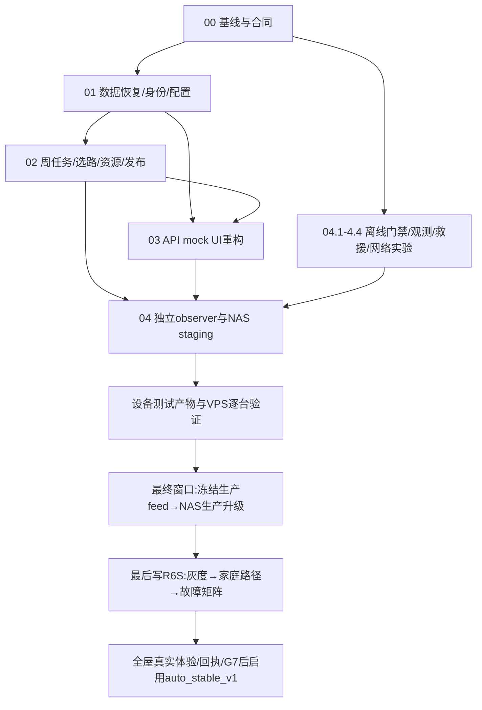

# MagicPanel V2 Agent 总执行方案 Implementation Plan

> **For agentic workers:** REQUIRED SUB-SKILL: Use superpowers:subagent-driven-development (recommended) or superpowers:executing-plans to implement this plan task-by-task. Steps use checkbox (`- [ ]`) syntax for tracking.

**Goal:** 在保住现有家庭联网和兼容数据的前提下，完成身份/检测/分流/DNS/界面/发布/恢复的完整迭代，以用户业务和真实生效证据验收，最后才改路由器。

**Architecture:** 保留FastAPI+SQLite WAL+Vue单体，收敛节点、配置、任务、计划、资源和发布的事实源。先隔离开发和NAS staging，旧生产与R6S持续提供现有代理；全部代码、资源恢复与独立视角验证完成后，再进入最终生产网络窗口，NAS生产升级后最后分步写R6S。跨设备状态不假定分布式原子提交，用revision、manifest、owner回执与回滚闭环。

**Tech Stack:** Python3.12（与当前运行镜像一致）、FastAPI/Pydantic/SQLite/cryptography/PyYAML/httpx/pytest；Vue3/Element Plus/Vite6；Node22构建与CI；Vitest3/VTU2/Playwright；固定版本Mihomo、实际Stash；Linux VM namespace/nft及现有OpenClash。

**Spec:** [总体设计](../specs/2026-11-15-MagicPanel-V2-总体设计与审查稿.md)、[工程规范](../specs/2026-11-15-MagicPanel-V2-工程检测与验收规范.md)、[体验与重构补充](../specs/2026-11-15-MagicPanel-V2-用户体验与重构补充设计.md)、[Google共同策略](../../reference/Google选路策略.md)、[开源研究](../../reference/2026-11-15-MagicPanel-V2-开源与检测研究.md)、本地私密[生产草案](../../network/2026-11-15-MagicPanel-V2-生产迁移草案.md)。

## Global Constraints

- 网络/DNS/WG/SQM以[家庭网络运行契约](../../reference/家庭网络运行契约.md)为唯一终态；本轮现场核验、专用DNS部署、电信/移动视角、家庭与外出设备范围按该合同执行。
- 必读[稳定性与覆盖验收补充](../specs/2026-11-15-MagicPanel-V2-稳定性与覆盖验收补充.md)：规则内容资格/时效、最终业务首命中、实际核心证据、运行漂移是发布门禁；自动稳定恢复的默认、阈值和执行边界以[自动恢复与检测策略](../../reference/自动恢复与检测策略.md)的`auto_stable_v1`为准。本补充落实在原任务，不新增平行架构。
- 用户已明确授权方案定案后完整实施、提交、部署与验证；当前先完成安全准备及合同收口，不把计划示例当通过。目标未实现不得标完成。具体网络切换在本计划末期受控执行，不重复索要已经授予的实施权限。
- Google **美国 → 新加坡 → 日本严格逐级回退**，当前档内按业务能力/IP质量/稳定性择优；任一美国可用仍用美国。全部适用上档候选有新鲜失败证据才回退，unknown/stale/未测/预算跳过不是失败；共同策略为唯一口径。
- Google/Gemini/Gmail/YouTube及完整依赖同一地区顺序；不再实行“仅美国”误读。Google规则优先宽泛AI/媒体；普通三档均失败不转DIRECT，核心整体基础联网是另一政策。
- 其他海外AI一个通用前台策略；AI排序和平局均不使用成本/价格/来源类型永久加分。流媒体再考虑地区、持续质量和费用。
- 最终交付模式为`auto_stable_v1`：每周全量、每日地区少样本、当前路径哨兵、异常逐级扩大检测、合格同地区自动切换，健康不换IP；全部频率、抽样、地区扩大判据、预算和防抖只消费[自动恢复与检测策略](../../reference/自动恢复与检测策略.md)。实施/灰度前关闭，G7通过后默认启用日检与有界事件恢复。住宅当前无资源，未授权零请求/字节。
- **成套网络与订阅切换最后**。用户最新允许前期唯一白名单`router.safe_preparation`：先手册/私密备份，交付不执行的救援脚本，冻结独立更新调度；不改WAN/LAN/PPPoE、DNS/UDP/IPv6/CN-bypass，不reload/restart核心或刷新订阅。其他router effect仍ROUTER_FINAL；NAS前期仍独立staging，不间接改生产feed。
- 国内服务故障隔离P0：DNS和快路不依赖代理节点/核心。用户已批准核心整体确认失败后由R6S外部coreguard撤本owner接管，临时恢复原生WAN，包含海外请求并告警；这与单业务节点/地区空池严格分开。核心退出/挂起、DoH故障、残留nft/conntrack、缓存、IPv6/UDP分别验收，不以全断网冒充恢复。
- 保留组/规则/侧栏相对顺序、sort、已有emit_name、方案隔离和旧订阅URL；新建 `(engine,platform)` 不重复，profile不是第四配置层。结构键保护、设备列表追加、cn-ip不加no-resolve等现有不变量继续执行。
- 凭据/私密节点定义/订阅令牌/私钥不进Git、日志、测试fixture或普通DTO；内存解密仅受控worker/渲染。用户未跟踪的ssh目录和已有修改原样保留。
- 路由器coreguard是必需网络职责；M5有界复核/合格同地区切换是`auto_stable_v1`最终默认交付，不再以人工确认为正常恢复路径。规则/DNS/核心变更与整包自动生产发布仍独立off；已有获准候选中的运行选择切换不等于重新发布整包。Stash本地recovery agent按实际能力执行，蜂窝/离线终端不等待NAS推送。

## 1. 交付文件、阅读顺序与owner

| 执行文件 | 交付 | 依赖 |
| --- | --- | --- |
| [01 核心数据与兼容迁移](2026-11-15-MagicPanel-V2-01-核心数据与兼容迁移.md) | 恢复、权限/DTO、稳定身份/typed refs、单一resolver、加密BLOB | 先做 |
| [02 检测选路与资源发布](2026-11-15-MagicPanel-V2-02-检测选路与资源发布.md) | 周任务/预算/observer/adapter、纯planner、Google档位证明、冻结/ACL、发布CAS与GC | 消费01；04.2可先提供runtime schema |
| [03 用户界面与体验闭环](2026-11-15-MagicPanel-V2-03-用户界面与体验闭环.md) | 9个UI任务、实际源码UX债、浏览器旅程与CI | API合同稳定后可mock并行，集成等01/02 |
| [04 生产验证与路由器末期迁移](2026-11-15-MagicPanel-V2-04-生产验证与路由器末期迁移.md) | 11项运行/恢复/离线网络/独立observer/设备/VPS/最终R6S任务 | 离线门禁可早开发；真实网络写仅最后 |

本总计划只固定跨任务合同、顺序和验收；每个代码任务的具体文件、测试代码、RED/GREEN命令和提交点在子计划，执行时两份一起读。编号始终带文件前缀，例如02/Task7与03/U05，不把不同计划的Task1混在一起。

**唯一owner**：01的`services/capabilities.py`管权限；02的`capability_evaluation.py`管业务证据。01的`resource_store.py/private_blobs`管加密字节；02的`resource_revisions.py`管元数据/manifest/GC。02唯一管feed freeze，04只调用。04唯一建runtime_observations表/服务/路由。03不得在JS重写planner、DNS合并、权限或节点身份。

共享`db.py/main.py/feed.py/package.json`只允许一个实施者同时编辑；并行Agent先写独立模块/测试，再按依赖串行合入共享入口。禁止最后盲目合并两份迁移或同名模块。

## 2. 执行前基线与环境

### 2.1 代码与隔离工作区

- [ ] 读AGENTS、三份正文档、交接、规格及本总计划，记录最新用户决定。设计基线为`6e50710786287e16519a8ec26fe2f2061612c320`，不是未来执行时永不变化的事实。
- [ ] 在原工作区只读检查；已有修改不自动stash/提交/丢弃：

```powershell
git status --short
git branch --show-current
git rev-parse HEAD
git ls-remote origin refs/heads/main
```

- [ ] 如果main已有新提交，先评估涉及文件与API漂移，更新执行基线/回归，不直接拿旧行号覆盖。只把经审查的文档变更作独立提交，绝不`git add .`混入ssh和用户修改。
- [ ] 执行期按using-git-worktrees技能与app原生工具建立/复用隔离工作区，分支使用`codex/`前缀。没有已审文档提交时，只复制明确批准的文档补丁并核对，不把未提交生产材料整包搬过去。
- [ ] 每任务记录开始commit；选择性提交自己的文件。实现代码在Git工作区，NAS `/opt/magicpanel`只作部署副本，不在那里临时修源码。

### 2.2 Windows本地命令

以下从隔离仓库根执行；虚拟环境若已存在先确认归属和Python版本，不覆盖用户环境。

```powershell
python -X utf8 -m venv .venv
.\.venv\Scripts\python.exe -m pip install -r server/requirements.txt pytest
npm ci
Push-Location server
..\.venv\Scripts\python.exe -X utf8 -m pytest tests -q
Pop-Location
npm run build
python -X utf8 scripts/check_secrets.py --all
git diff --check
```

测试环境默认`MAGICPANEL_SCHEDULER=0`和隔离临时数据；现有client fixture会清理app模块，涉及app的测试在fixture初始化后导入。外部网络mock/deny，不复用生产secret.key或真实订阅。单元测试不启动真实核心，真实核心加载在04隔离矩阵里完成。

02/Task2必须在运行依赖锁定`tzdata==2026.6`（本次已核PyPI），并验证`PYTHONTZPATH=''`子进程仍可加载Asia/Shanghai。Windows常无系统IANA库，不能只在Linux通过就声称周调度跨平台；这是小时级任务正确性的必要依赖，不是新增后台服务。[Python时区数据说明](https://docs.python.org/3.12/library/zoneinfo.html)、[tzdata](https://pypi.org/project/tzdata/)。

POSIX执行同一任务用`.venv/bin/python`；`deploy.sh`依赖Bash/rsync，不能把路径换成PowerShell就假装可运行。最终部署在已验证的Bash环境执行，脚本参数以该提交`--help`/源码为准，不猜测未有选项。

## 3. 统一合同：避免几份计划各造一个系统

### 3.1 身份、版本与私密内容

- `node_uid`持久随机ID；`revision:int`只表示连接材料，`catalog_revision:int`表示目录/名称/启停元数据。改名不作废连接证据，emit_name由计划/manifest另外冻结。
- `NodeKey={node_uid,revision}`；typed member=`{kind:'node'|'group'|'builtin',ref:str}`，group.ref为同variant组ID十进制串。数组顺序即优先级。
- NodeSummary安全字段=`node_uid/revision/origin_kind/source_id/local_node_id/raw_name/display_name/emit_name/enabled/meta`；列表外壳含catalog_revision。可选observations只含02安全证据，**不要求每个条目再带catalog_revision**。
- 01服务签名以其§0为准：`list_active_nodes/get_revision`不回秘密，`load_probe_material(conn,node_uid,revision)->dict`仅受控内部调用；权限统一`require_capability(user,action)`。
- 01私密BLOB用`put_private(conn,kind,body)->{blob_id,kind,size,ciphertext_sha256}`；02资源revision只引用blob_id，不再建第二份文件CAS。事务中保证节点/资源引用和BLOB一致。

### 3.2 HTTP、错误与动作

所有新分页`{items,total,limit,offset}`，nodes再带catalog_revision。所有写动作CSRF+能力授权；普通GET不发起探测/刷新/发布。错误外壳：

```json
{"detail":{"code":"stale_revision","message":"数据已变化，请重新预演","request_id":"fixture-request","fields":[],"references":[],"expected_revision":1,"current_revision":2}}
```

`fields/references/expected_revision/current_revision`可省略，request_id是安全关联ID，context不得含URL令牌、定义、controller凭据。保留ApiError.detail，不把结构化错误变成单一toast后丢信息。

| 动作 | 合同与副作用 |
| --- | --- |
| nodes/rename | 01定义；preview零DB写返回签名preview_id，apply带preview_id+expected_catalog_revision并事务消费；无网络/发布 |
| probe preview | POST `/api/v1/probe-jobs/preview`，冻结NodeKey/服务/observer范围，返回preview_token、digest、上界、blockers与版本；token绑定actor/评价时刻和payload，TTL300秒 |
| probe create | 同payload+preview_token+expected_preview_digest+idempotency_key，重算/CAS/一次预留预算后202 |
| route preview/explain | POST `/api/v1/routing/preview`与`/routing/explain`，view+CSRF/相应编辑权限；零网络、零外部写 |
| plan accept | POST `/routing/plans/accept`，edit+CSRF，body含preview_token/plan_sha/expected_plan_sha/expected_revisions/idempotency_key；不改sort/锁定，不构建发布 |
| publish/rollback | 新调用必须idempotency_key+expected_release_revision；与env指针同事务CAS，旧表单409 |
| release状态 | 保留production/testing旧字段，新增release_revisions:{production,testing}，空环境0；不是build_id |
| runtime观测 | 04实现GET/POST `/runtime-observations`；POST仅存注册collector的白名单只读结果，不收URL、shell、完整YAML |
| 运行选择唯一写者 | 04.7定义execution_scope/owner/epoch；终端按设备、R6S按实际共享select划scope，本机owner独占写选择与selection_revision，NAS只镜像签名receipt，不能另起中央CAS或跨owner PUT |
| 恢复proposal | POST `/runtime-recovery/proposals`及兼容`/apply`只接受runtime_write+CSRF建议，202 proposed不等于切换；本机按最新revision/ref/锁/epoch复验后执行；NAS无controller写入口 |
| 恢复receipt/对账 | 04负责`/runtime-recovery/receipts`与state；owner签名+epoch+连续receipt链更新镜像，重放幂等/分叉隔离；备份恢复未完成intent不重放，先只读reconcile；Python/JS/Ruby共享04.7 golden traces |

routing preview返回900秒preview_token，probe preview返回300秒preview_token，均用既有Fernet认证加密并绑定purpose/version、actor、scope/规范payload、evaluation_at、input摘要与expected revisions。首次/未完成accept或create验签/TTL/当前权限，按冻结时刻重建输入再CAS/重核当前预算；token坏403、过期或数据变化409。已经完成的同语义幂等重试可返回原结果，即使token过期也仍须验签/actor/purpose/当前权限并匹配完成ledger，不能新执行。重启不靠内存，随机token不进入plan_sha/manifest/日志。签名预演不是授权替代品。

连接材料/来源目标/凭据修改须edit+reveal，安全metadata只需edit；runtime_write授权向固定owner提交运行修改proposal，不授NAS跨owner直接写控制器；本机选择执行与签名回执按04.7。门户免PIN限后端确认的reveal会话，普通viewer session不取得订阅token；有效PIN只授门户范围，不授管理reveal。

Job状态统一queued/running/paused/incomplete/completed/cancelled/failed；取消中的UI本地文案不发明后端完成状态。route trace的stage使用`state`，不是另一份`status`；缺运行事实unknown。caller传`evaluation_at`，纯函数不读系统时钟/网络/数据库。

plan_sha、eligibility_sha、build_input_sha和原始observation revision不混用；80→82ms或完成时间变化不重建。owner bundle生命周期是prepared/partially_applied/verified/rollback_required，跨机器没有假原子事务。

### 3.3 并发与事务规范

- 所有服务接收caller的conn，不自行commit；HTTP/CLI边界短事务。抓取/网络/核心启动/大文件校验不得持SQLite写锁。
- 有界job租约、滚动预算预留和幂等请求跨重启持久；重复key同payload返回原响应，异payload409。
- 发布同一`expected_release_revision`竞争只一成功；production/testing各自单调revision，一个环境一个指针；回滚也CAS，审计与指针同事务。
- V2自动化不能伪装legacy调用绕过前置条件；legacy兼容来源由可信服务入口判定，不信任客户端传origin。
- 保留manual lock，版本变化必须重新预演，不静默覆盖。清理资源先mark、事务重验引用/lease再sweep；同时保护node_revisions、build资源、freeze与活跃客户端。

### 实际拓扑与验收主次

家庭由R6S统一透明代理；NAS、Mac mini及Apple TV走家庭透明路径，不安装日常终端代理。NAS为检测临时启动的core仅限隔离worker，不接管NAS常态流量。外出主用现有device 1 `iPhone-Stash`（target ios）、device 2 `MacBook-Stash`（macos）、device 5 `Android-Stash`（android）。Android target是实际数据；各平台版本/API/cron/脚本/本机鉴权/强制叶/选择读回由04分别预检，不能把iOS能力套给Android/macOS，也不能因印象否认Android。

G7首要真实验收为家庭R6S透明路径（含Apple TV）及上述外出终端的本地自动恢复。脚本/本地控制器等最低能力不足时先升级/适配再验收，不能以不支持或逐次手动切换标为交付。Apple TV不以安装Stash tvOS为家庭联网前提。旧Mac mini/TV与Windows等他人兼容target保留，不按久未拉取删除；按实际用途维护兼容，不误当主用外出设备。

WireGuard只用于外出回家访问NAS/路由器等内网，保留明确内网AllowedIPs；不是全流量出口，不承担普通海外代理或蜂窝恢复。回家可达与本地代理恢复分别验收。国内故障全矩阵含core健康但所有代理节点失效/变慢，国内DNS、本地服务与DIRECT不得等待海外恢复；只有核心整体故障触发已批准的原生WAN模式。

客户端统一Stash；Android商店1.1.10（ws.stash.app，Nov 4）与Windows早期兼容为已确认事实，不再询问产品存在。installed版本和本地自动恢复能力仍由04逐平台inventory核验，商店页不能代替实际设备能力。

## 4. 实施依赖与生产顺序



**前期NAS只staging**：独立容器、独立data/密钥、loopback端口，`MAGICPANEL_SCHEDULER=0`，不写生产数据库或alias、不复用生产controller操作。生产和R6S在staging发布前后只读摘要比对。迁移恢复可用受限私密备份在隔离目录验证，不能让恢复后的真实订阅启动scheduler。

**冻结能力先离线实现，真正安装/arm在最终窗口**：02/Task8的兼容reader无需提前给生产加长期sidecar。最终窗口先取R6S raw与实际缓存provider/MRS，和NAS live分发核对；不同不能悄悄刷新R6S消差异。准备/arm快照后，安装仅冻结兼容入口并验证，再允许V2生产迁移。快照含最终envelope/实时overlay/全部引用资源；共享无设备alias冻结全局旧字节，新测试客户端走版本URL，不按UA猜身份。

兼容reader应能在完整V2初始化失败时独立服务，私密快照reader的启动不导入V2迁移；部署的最小兼容提交、监听/代理接线与旧image回退均先在staging演练。最终窗口若现有NAS入口不支持无间隙兼容切换，就停止并保持旧生产，而非一边升级一边补freeze。无条件用“先发布再freeze”不合格。

在ROUTER_FINAL之前，仅允许注册且已核验副作用的`router.safe_preparation`。除此之外禁止R6S订阅/provider刷新、切组、改实际DNS/网络UCI/nft/路由、安装包/核心、reload/restart、NAS发新资源间接生效。独立VPS结果只代表vps observer；真正NAS直拨资格在最后旁路验收后才建立。

## 5. 逐阶段门禁与停止线

| 关卡 | 必须完成 | 允许继续的证据 | 不过时行为 |
| --- | --- | --- | --- |
| G0 基线 | 代码/数据/所有sort/方案/目标/设备/生产digest/现有自动任务清单 | 安全摘要、恢复点可读、差异归属清楚 | 不开始写入/部署 |
| G1 本地底座 | 01迁移/恢复/DTO/typedrefs/resolver | 两次迁移一致、旧产物基线保序、空目录解密恢复 | 保留旧schema读写路径，修任务不修生产 |
| G2 业务核心 | 02所有任务，04 runtime schema与离线实验 | 零外网测试、预算/熔断/Google完整档位/资源冻结/ACL/CAS全过 | 不给新算法控制真实设备 |
| G3 用户闭环 | 03旅程、Node22构建/CI、本地浏览器 | 4/6PIN、无隐式请求、409保稿、Google解释、窄屏与scope竞态 | 不以build通过替代交互通过 |
| G4 预网络验证 | NAS staging、独立observer、备份恢复、真实核心矩阵、VPS对照 | observer视角正确、旧生产与R6S摘要不受影响、离线image真恢复 | 不动路由器，暂停产生外部影响的任务 |
| G5 最终包 | 04.9、救援、离线材料、回滚、灰度设备、具体owner输出 | 管理通道不依赖将改代理，freeze/缓存差异已解决，审批窗口明确 | 保持现网，不以测试需要为由先加旁路 |
| G6 最后网络 | NAS生产兼容冻结/升级后，逐项R6S灰度 | 国内全故障矩阵（含core健康而全节点失效/变慢）、Google美新日、DNS/no-loop、UDP/IPv6、家庭path资格与回执 | 自动回退/人工救援；先保开发连接再改代码 |
| G7 业务推广 | 家庭透明含AppleTV，外出iOS/macOS/Android主用Stash、GitHub/TikTok持续体验与canonical观察周期 | 确认加载/实际出口/持续播放与预算；未覆盖明确列出 | 不宣称基本完善，不开启自动生产 |

最终自动恢复归原任务实施，不新增平行系统：

| 原任务 owner | 必须补齐的同一交付 |
| --- | --- |
| 02/Task2–3、6–7、9 | 按canonical注册周全量/日地区少样本/当前路径哨兵/事件任务、预算与逐级扩检；主力故障独立处理、同地区合格候选自动接受运行选择，正常不换IP；Google跨档仍须完整上档失败证据 |
| 04.2/4/7/9–11 | R6S外部coreguard原生WAN恢复；分别实现/预检主用iOS、macOS、Android的本地recovery agent/脚本/本机控制器/强制叶与读回最低能力，不把蜂窝恢复交给NAS推送；能力不足先升级/适配再验收，作为G7最低能力，不视作可选；家庭Apple TV只验透明路径，WG仅回家内网 |
| 03/U03/U05/U07 | 展示阶段关闭/最终启用、日检样本和扩检原因、自动恢复历史、少变动与失败分支；运行切换与规则/DNS/核心/整包发布开关分开 |
| 01/Task10–11 | 保存受控策略版本与阶段/作用域边界，迁移和恢复不自动发任务；执行启用由02/04在G7后按canonical消费 |

关键生产写由04注册operation/effects决定阶段，不能只看命令在哪台机器执行；即便NAS命令使R6S自动更新也算router effect。失败重试必须回到原关卡核对输入revision，不能跨阶段补一条命令绕过。

G2/G4补充必过反例：HTML/坏MRS不覆盖好规则、规则长期未复核不能自动生产、缺核心且core_checked=False不得发布、最终产物关键业务首命中无误分流。G1完成后可先在隔离副本验证迁移/恢复/旧产物，尽早证伪核心假设。最终生产分窗：NAS升级且旧feed冻结验证后可结束第一维护窗口，保持R6S不写；稳定检查通过后另开R6S窗口，不把两种大变更强行连续执行。

## 6. 测试与需求覆盖矩阵

| 用户要求/历史债 | 主要实现/验收任务 | 必测反例 |
| --- | --- | --- |
| 国内独立与全屋透明 | 02/Task9–10，04.4/04.10–11 | core stop/kill/hang、core健康但全节点失效/变慢、DoH超时、残留redirect、热Fake-IP、共享IP、v6/UDP；国内不等待海外恢复 |
| Google严格美新日 | 02/Task7/9，03/U05，04.4/04.7 | US任一可用而SG快；仅主备坏；unknown/预算跳过；完整上档耗尽 |
| 全源AI质量优先/不计成本 | 02/Task5–7，03/U05 | 机场胜自建、改cost不改排名/平局、单项服务fail不全淘汰 |
| 稳定ID/改名分类 | 01身份/引用/命名任务，03/U04 | 同名跨源、同IP多协议、凭据换版、消失重现、409、排序不变 |
| 周检/日检/有界恢复不过频 | 02/Task2–3/6–7/9，03/U03/5/7 | canonical日检抽样与两轮地区确认、主力故障独立复核、健康不切、重启不全扫、无隐藏600秒递归 |
| NAS测试真实性 | 02/Task4，04.5/04.10 | trust_env=False仍二次代理、VPS冒充NAS、节点DNS污染、path epoch变更 |
| 流媒体地区和费用 | 02/Task5/7，03/U05，04.7 | 首页200非播放、DRM/权益、YouTube不能为省钱越地区、连续视频 |
| 未来住宅 | 01元数据/授权，02/Task3/12 | 未授权0请求、通用health排除、设备token横取、离线凭据不能即时撤销 |
| 真冻结/真回滚 | 01备份/BLOB，02/Task8/11–13，04.3/6/11 | 改live旧revision不变、缺密钥/variants/资源、旧digest未真加载、缓存残留 |
| 用户体验和误报 | 03/U01–9 | GET暗测、下载当加载、PIN4位抢提交、旧scope响应、force发布暗含全测 |
| 规则/DNS/模式严谨 | 01resolver，02/Task9–10，03/U06，04.4/10 | DOMAIN/SUFFIX放宽、classical误声明、cn-ip no-resolve、cloud ASN抢CN、AGH跨方案覆盖 |
| 并发与权限 | 01能力/DTO，02/Task12–14，03/U07 | 双发布旧表单、重key异body、HEAD304/preview绕ACL、普通列表含secret |
| 路由器最后/救援 | 02/Task8，04全部phase门禁 | NAS生产提前发新feed、共享legacy别名漏冻、无独立救援、整体fw4 flush |

所有新增测试使用合成/脱敏fixtures。模型测试mock网络，协议层用loopback假服务，核心加载用固定二进制隔离；真实节点、账号和家庭透明AppleTV业务另取授权样本，不用单元测试向全网发请求。UI的Playwright只测自有localhost/隔离实例，不接管用户已有浏览器认证会话。

最后本地发布候选检查（03设施已完成后）：

```powershell
Push-Location server
..\.venv\Scripts\python.exe -X utf8 -m pytest tests -q
Pop-Location
npm run test:ui
npm run test:e2e
npm run build
python -X utf8 scripts/check_engine_defaults.py
python -X utf8 scripts/check_secrets.py --all
git diff --check
```

不无意义重复全量测试：每任务跑定向红绿与相关回归，每个集成关卡再全套。代码后续改变、失败或依赖漂移才重跑受影响检查。本次文档写作没有运行这些尚未实现的测试。

## 7. 实施Agent的工作规范与进度记录

- [ ] 开始任务前读它的Files、Interfaces和前置receipt，核对实际函数与版本，不按旧行号盲改。
- [ ] 测试先描述真实行为反例，跑出预期红灯；语法错/错误fixture/真实外网失败不算有效红灯。
- [ ] 实现最小完整责任单元，网络、规划、HTTP、持久化分层；避免大而全helpers或第二事实源。
- [ ] 状态/时间/版本必须显式，未知不是失败；UTC存储、Asia/Shanghai调度，测试注入时钟。代码注释只写必要原因。
- [ ] 完成定向绿灯→审查接口/迁移/安全→相关回归→选择性提交→更新receipt。不要把未跑测试写PASS。
- [ ] 其他Agent可并行独立模块；共享文件串行。接收跨任务消息先对合同，不能让两个同名模型同时存在。
- [ ] 出现网络变更/数据丢失/权限扩大/顺序漂移/错误出口/回滚不完整，立即停当前阶段，保留证据和最近可用版本；不通过关闭校验修报错。

每任务保存以下安全记录（私密材料另存受限目录，不能粘贴进Git）：

```json
{"task":"02/Task7","base_commit":"reviewed-base","result_commit":"reviewed-result",
 "status":"not_started","tests":[],"spec_refs":["Google选路策略"],
 "input_revisions":{},"evidence_hashes":{},"blockers":[],"router_effects":[]}
```

status使用not_started/in_progress/verified/blocked；blocked是任务进度，不擅自改变Codex用户Goal状态。执行日志不记PIN/订阅路径/节点定义，只记安全ID/hash、命令类别和结果。每个阶段给用户简明完成/未完成/风险与下一关说明。

## 8. 最终交接和完成判据

交付需包含代码/迁移版本、需求映射、每任务receipt、真实测试报告、staging/生产镜像digest、备份恢复结果、各owner版本与设备加载情况、Google档位/证据、每周真实探测开销、路由器改前/后脱敏diff、回滚演练和已知限制。

没有主用iOS/macOS/Android本地恢复、家庭透明AppleTV、账号与全故障矩阵样本就记未验证，不能以YAML解析或首页200补齐。发现未知国内服务或新的Google依赖，走版本化规则/回归补充，不对静态列表承诺永久穷尽。未达到G7不宣布整个项目完成；G7先确认日检/扩检与本地自动切换的灰度验收及启用条件，通过后默认启用`auto_stable_v1`并记录启用复核回执，才完成交付。实现期off不是最终人工模式的替代交付；整包自动生产发布仍独立关闭。

用户已设完整交付目标为active；本执行方案收口后持续逐项实施，不停在文档交付。实现、部署、测试与最终网络切换分别记录证据，不因完成文档就把用户目标标complete。

## 9. 交付前完整评审记录

本轮完成总计划自审及数据架构、能力/选路、生产网络三个视角的交叉评审。评审范围包括规格覆盖、跨计划依赖/owner、字段/接口/事务、示例代码、权限、阶段与恢复；独立评审指出的下列P1均已修订并复核，不留给实施Agent猜测。

| 发现 | 处理结果 |
| --- | --- |
| Google此前被解释成仅美国 | 全文统一美国→新加坡→日本；完整上档失败才回退，unknown/预算跳过不算失败；撤回额外绝对阻断架构 |
| 路由器最后只防SSH写，仍可能被NAS发布自动改变 | 前期只独立staging；生产NAS/reader/freeze和R6S写全归最终窗口，最终envelope/缓存子资源一并核对 |
| phase_guard只识别router.*，不拒提前生产DB/image/freeze | 除已明确授权且固定effects的router.safe_preparation，其他router.*、nas.production.*、freeze.production.*仍强制ROUTER_FINAL；固定registry/ACTIVE与顺序proof，不能用名称或hash不变冒充安全 |
| probe/routing preview零写却需后续恢复输入，两次now又使摘要失配 | 认证加密token绑定actor/purpose/固定评价时刻/输入版本，300/900秒TTL；重启可重建，正式提交重核当前状态并持久幂等 |
| rename preview暂存表与零写合同冲突 | 改无状态签名preview_id，apply才事务消费/CAS，过期/篡改/重启/目录变化有测试 |
| 节点meta/attributes、单项catalog_revision、trace字段不统一 | HTTP统一meta、catalog_revision在外壳/scope；实际01 DTO作contract fixture；trace.stage.state统一 |
| 串行发布仍可被旧页面覆盖，重试可能重复 | 环境指针单调expected_release_revision+幂等key，同事务校验/审计，rollback同样CAS；UI不使用build_id冒充版本 |
| 私密字节/资源/采集表存在重复owner风险 | 01唯一private_blobs，02资源revision引用，04唯一runtime schema/API；helper文件只追加不覆盖 |
| operator可保留旧秘密却改目标外发，普通viewer可借门户取得token | 连接/目标/凭据edit+reveal，metadata只edit；免PIN限明确reveal会话，PIN不等同管理权限 |
| 旧镜像回滚只设IMAGE_TAG但Compose未使用 | 04要求digest override、离线no-build/no-pull并核实际运行image；不把变量设置成功当回滚完成 |
| UI/调度仍有PIN竞态、24h误报、一天上限、隐含600秒检测 | 03逐项行为测试；02 API/能力/编译一起支持周值/显式禁用，浏览GET零主动检查 |
| Windows无IANA时区、工作机Node26与镜像Node22不同 | 02锁定tzdata并测无系统库；UI/构建以Node22 CI验证，不只依赖本机环境 |

最终文档校验覆盖全部交付链接、围栏、占位/乱码/空白、示例Python AST/JavaScript语法、凭据模式与Git diff。阶段门禁的示例另做了有限纯逻辑场景验证。**这些不是尚未实现的业务测试、浏览器E2E、迁移、真实核心/账号/设备或生产故障注入通过记录**；实施Agent须按每个任务实际运行并填receipt。

上述记录是前轮合同评审范围。本轮业务稳定性专项又发现规则内容/时效、缺核心自动发布、业务回归门禁不足及完整备份加密遗漏，已在补充规格和01/02/04任务收紧；这些是未来必修项，现代码尚未修复。不能以文档一致替代日常稳定性证明。早期设计阶段未部署；用户之后已授权完整实施及路由器安全准备。当前阶段、变更与实际测试以任务receipt/现场记录为准，不能继续沿用早期“仅文档”状态描述。
