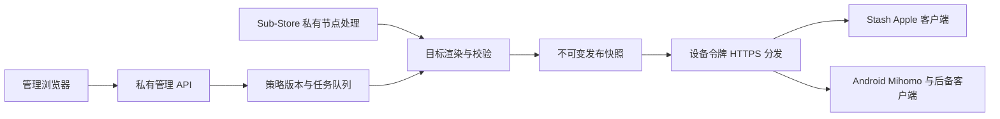

# MagicHub 远程配置管理：架构与开发规格

日期：2026-10-19；状态：**开发设计，尚未实现或部署**。最新决定：用户已购买 Mac 授权，Windows + 两台 Mac 目标均为 Stash；Android 仍有 Mihomo 输出需求。对应[最终客户端选型](../network/Client-Selection-and-Compatibility.md)。目标是一个家庭、一位主要维护者、多设备远程订阅；不开发代理内核、不把云端变成流量中转、不依赖 Stash iCloud 同步。

## 最佳起点与现成工具边界

建议采用 **自有域名 + 独立 Linux VPS + 私有 Sub-Store + 两类配置模板 + 版本化 HTTPS 发布**。先做可用的远程配置，再逐步补齐 Web 工作台；无需为了开始统一管理先开发一套完整后台。

| 方案 | 适合之处 | 本家庭的选择 |
| --- | --- | --- |
| 自建 Sub-Store，配置文件分别维护 | 已有订阅整理、合并、过滤、脚本、文件管理和分享能力 | **第一阶段优先复用**；不能误写成只支持节点转换 |
| Sub-Store + MagicHub 发布工作台 | 补统一策略、目标能力检查、版本、灰度、审阅与回滚 | **长期推荐**；自建 Web 可行，但重点开发家庭所需的编排层 |
| 公共订阅转换站 | 无需部署 | 不作为凭据处理方；操作者能取得机场订阅与生成配置 |
| Subconverter／模板转换 | 适合已有模板的批处理 | 可作受控适配器，不额外串多级转换；转换输出仍需目标校验 |
| Git + CI + 私有发布器 | 开发初期便于审阅、重现、回滚 | 可作为第一阶段实现，含凭据产物不得进入公开 Git／Pages／公开 CI artifact |
| metacubexd／zashboard 等 | 运行中核心的节点、连接、日志控制 | 可给 mini 提供受控 LAN 管理；不能代替策略源、编译器或多端订阅发布 |

已核查 [Sub-Store 2.42.6](https://github.com/sub-store-org/Sub-Store/releases/tag/2.42.6) 的[文件接口](https://github.com/sub-store-org/Sub-Store/blob/2.42.6/backend/src/restful/file.js)、[Mihomo 文件类型](https://github.com/sub-store-org/Sub-Store/blob/2.42.6/backend/src/utils/file-type.js)与[分享令牌实现](https://github.com/sub-store-org/Sub-Store/blob/2.42.6/backend/src/restful/token.js)：上游已有完整配置相关处理和分享令牌，不重复发明这些能力，也不假定这些接口天然满足本项目全部发布隔离要求。是否直接复用令牌，须完成作用域、日志和路由测试；上游内部 API 应封装适配、固定版本。

注意 [Sub-Store 官方域名说明](https://github.com/sub-store-org/Sub-Store/wiki)：`sub.store` 是脚本重写使用的域名，并非项目拥有的公网服务。部署使用自己的域名；不把此域名当默认可信订阅服务。

## 部署位置：管理面独立于家庭基础网络

- **生产放独立 VPS**，不是 NAS／mini 上唯一一个容器。家庭停电或 NAS 维护不影响外出设备首次下载／更新；现有有效配置继续本地运行。云端只处理少量配置流量，不需要千兆代理带宽。
- 首期单 VPS 即可，按家庭规模可从 2 vCPU／2 GB 内存级别评估，构建隔离任务串行执行并测内存；这是容量起点，不是性能保证或必须购买的规格。不先选昂贵 HA、Kubernetes 或 Redis。
- 自有域名稳定 HTTPS；在家庭直连、蜂窝、外出网络分别测试 DNS、TLS 和下载。选地区／商家以这些测试、备份与维护能力为准，不能凭“海外”或 CDN 品牌承诺可达。订阅入口不能必须先打开已失效的代理才能修复代理。
- mini 做可选 LAN 代理，NAS 做加密异地备份的一个副本；两者均不做唯一控制面。异地另留一份加密备份与离线应急配置。
- Cloudflare Tunnel 可以免入站映射，但若源服务放家中，家中停机仍会失联；不解决独立发布要求。[官方 Tunnel 文档](https://developers.cloudflare.com/cloudflare-one/networks/connectors/cloudflare-tunnel/)
- Workers／D1／R2 可以作为后续只读分发方案，但 Workers 的 Node 兼容不意味着可直接执行 Linux Mihomo 二进制；仍要独立构建／验证环境，不是把 Docker 服务原样搬过去。[官方运行时说明](https://developers.cloudflare.com/workers/runtime-apis/nodejs/)



图中没有代理流量经过管理服务器，也没有通向 R6S DHCP／DNS 的控制路径。

## 技术栈与仓库落点

目前仓库是配置、规则、转换脚本与静态资源集合，没有现成应用服务器或前端工程；不能把设计写成已有功能。建议以独立目录新增，不替换现有规则生成工具。

| 层 | 建议实现 | 约束 |
| --- | --- | --- |
| 管理 UI | React + TypeScript + Vite，CodeMirror 6 编辑器 | PC／移动浏览器均可；中文界面；先结构表单再高级源码模式 |
| API | Node.js 当前受支持 LTS + Fastify + TypeScript | 实施时核对支持版本并锁依赖，不从“最新主版本”推断稳定 |
| 策略／版本数据 | SQLite WAL、本地磁盘卷，数据库任务表 | 单实例单写入服务；不放 NAS／NFS 共享卷；规模扩大再迁 PostgreSQL |
| YAML | `yaml` 的 Document／AST API；JSON Schema + 语义检查 | 尽量保留注释、位置和未知字段；拒绝危险标签、重复键、超限 alias |
| 节点处理 | 私有 Sub-Store 固定版本／镜像摘要 | 只暴露给内部适配器，节点转换行为有脱敏夹具 |
| 发布／验证 | 独立 worker；固定 Mihomo 版本的无特权隔离进程 | 不共享 Docker socket；校验不是在 API 进程执行 shell 任意命令 |
| HTTPS | Caddy + 单机容器编排 | 只公开管理认证入口和只读 feed；数据库与 Sub-Store 不开放公网端口 |

依据：[CodeMirror 官方源码迁移入口](https://github.com/codemirror/dev)、[YAML AST](https://github.com/eemeli/yaml)、[SQLite WAL 限制](https://www.sqlite.org/wal.html)、[Caddy HTTPS](https://caddyserver.com/docs/automatic-https)。CodeMirror 的 GitHub 开发仓库已归档并指向新的官方托管站，不能误判其已停止维护；安装使用受支持的独立 npm 包。上述是栈的设计选择，正式开发时还要按官方文档确认兼容版本。

```text
apps/config-console/       # 管理界面
services/config-api/       # 身份、设备、策略、只读分发
services/config-worker/    # 受限抓取、编译、验证、发布
packages/policy-model/     # 公共策略数据模型
packages/target-adapters/  # stash / mihomo；未来再增加 sing-box
packages/substore-adapter/ # 固定上游 API 的内部边界
policy/templates/          # 无凭据目标模板与转换代码，Git 审阅
policy/schemas/            # 版本化派生 schema，标注证据来源
fixtures/config/           # 脱敏输入、语义与失败用例
```

运行数据、主密钥、含凭据构建产物放仓库外专用数据卷，不是新增一个未被忽略的 `dist/`。现有 `.github/workflows/deploy.yml` 会在 main 推送后远程强制更新仓库；**不能把它当作新服务部署器**。开发时新增独立构建／发布流程，审查输出路径，避免被 `git clean -fd` 清掉运行数据。

## 页面与用户流程

| 页面 | 首期必须具备的能力 |
| --- | --- |
| 总览 | 当前稳定版本、候选版本、每目标校验状态、上游最后成功更新、待审差异、设备最后下载时间；不伪装实时在线监控 |
| 节点来源 | 添加／禁用机场 URL、隐藏凭据、手动刷新、定时抓取、流量到期信息、地区标签、过滤与命名；显示原始协议和转换损失 |
| 策略组 | 通用、AI、视频、下载／游戏；地区偏好、手选／测速／故障切换；预览成员、拒绝空组和组循环 |
| 规则中心 | 个人例外、LAN、业务、地域、拒绝、兜底；规则源更新差异、去重、冲突提示、按目标支持情况筛选 |
| 插件中心 | 类型、来源、目标、版本／摘要、参数、依赖、权限、启用范围、更新 diff；不能只放一个无类型“插件 URL”输入框 |
| 模板与编辑器 | Stash iOS／MacBook／mini／TV／Windows、Mihomo Android／Windows 后备；可视表单、YAML 源码、错误定位、渲染预览、默认脱敏 diff |
| 设备 | 设备名、平台、客户端／实际核心版本、模板、策略标签、灰度通道；复制订阅 URL、二维码、撤销／轮换令牌、下载应急配置 |
| 发布历史 | 候选构建、证据与测试、差异、批准、单设备灰度、稳定发布、指定版本回滚、失败原因 |
| 设置／审计 | 身份与恢复方式、加密备份、域名、调度、告警、脱敏日志、官方文档核对记录 |

典型流程：新增个人域名例外 → 编辑器显示各目标路由变化 → 构建候选 → Mihomo 解析与语义校验／Stash 实机确认 → 一个设备试用 → 发布稳定 → 设备随后拉取。新增节点来源不要求重写规则；插件更新不自动发布给全家。

设备页的“复制订阅地址”复制固定的**设备专属完整配置地址**，不是机场原始 URL，也不是一次性候选链接。显示“含访问凭据，泄露可撤销”；二维码同样是凭据。首次生成只显示一次，之后可轮换新令牌；不在页面 analytics、错误上报或 URL 预览中上传。完整配置下载和复制经明确操作，普通预览保持脱敏。

## 数据模型与单一权威来源

模板／适配器代码在 Git；实际策略记录与版本在数据库；导出无凭据策略供 Git 审阅时标记版本，不能让同一规则同时由 Git 文件和数据库双向自动覆盖。若第一阶段选 Git 为策略源，则 Web 只提交变更提案，不能再直接改另一份生产数据；切换到数据库权威必须一次迁移并声明。

| 实体 | 关键字段／关系 |
| --- | --- |
| Source | id、类型、加密 URL／凭据、抓取策略、最近成功快照、失败计数 |
| NodeSnapshot | source_id、内容摘要、脱敏元数据、加密原文、协议特征、来源证据 |
| PolicyRevision | 不可变 id、父版本、规则／策略／目标选择、作者、schema 版本、创建原因 |
| RuleSource／RuleItem | 来源／版本、domain／ipcidr／classical、顺序、动作、目标限制、个人例外 |
| PluginRevision | 类型、内容摘要、来源、版本、参数定义、权限、目标、依赖与固定资源 |
| TargetProfile | engine、platform、app_version、core_version、模板版本、能力条件、启用插件 |
| Device／FeedToken | device_id、target_id、channel、令牌摘要、权限范围、撤销状态、最后拉取 |
| Build／Artifact | policy_revision、节点／规则快照、适配器／核心版本、校验结果、加密产物、资源哈希 |
| Release／Channel | 发布集合、目标到产物映射、稳定／灰度指针、审阅结果、回滚来源 |
| Audit／Job | 对象、操作、前后版本／脱敏差异；任务类型、幂等键、租约与重试状态 |

公共模型只描述能明确表达的语义：节点来源引用、地区标签、业务动作、顺序规则、策略关系。**不把所有引擎字段压成最低共同子集。** 特有配置保存在带目标与来源的扩展区；已知不支持则阻断或要求显式可见的降级决定，未知能力显示“未验证”。不得静默丢弃 Reality、传输、证书校验、UDP、规则或重写。

能力记录是 `(目标客户端, 版本, 平台, 核心版本, 特性, 参数约束, 官方URL, 核对日期, 实机结果)`；不是一个全局 `supportsVless=true`。Windows Stash 的精简输出列出未验证／未启用的 Apple 专属功能；CVR 后备另外显示方言差异。

## 规则、配置和插件如何分类

规则按**匹配数据**与**策略动作**分开：同一域名集可共用，不把某客户端组名硬编码进共享源。按首次匹配语义生成，保持显式优先级：必要本地访问 → 用户例外 → 经审阅的拒绝 → 业务分流 → 地域 → 兜底；具体例外可覆盖，不能自动排序改变含义。domain、ipcidr、classical 分目录／标签；复杂进程／逻辑规则按目标限定。上游大更新先比较增加／删除比例，异常空集禁止自动发布。

| 插件类型 | 管理边界与执行位置 |
| --- | --- |
| 节点处理器 | 命名、过滤、标签、合并；优先使用声明式操作，必须脚本时在隔离 worker 执行 |
| 配置覆写 | 引擎／平台限定的有序 patch；声明数组替换／追加／按 ID 合并语义和冲突，不套用全局 deep-merge |
| 规则包 | 域名、CIDR、复杂规则；版本固定、来源、目标、哈希和策略映射 |
| HTTP 重写／MitM／请求脚本 | Stash 运行时专项；缺省关闭、单独审核证书与主机范围；不得转换成普通 Mihomo 路由规则 |
| 定时脚本／Tile／客户端专用模块 | 仅发给经过版本验证的目标；明确权限、依赖、环境参数与密钥引用 |
| 核心／客户端／面板 | 单独记录软件版本，不伪装成可随规则自动更新的插件 |

Stash Override、CVR JS、Sub-Store 节点处理脚本是不同机制。每个插件有 id、类型、语义版本、下载来源、固定摘要、适用版本、输入参数、依赖、权限、变更日志；更新先构建候选，禁止配置获取时在线执行任意最新远程脚本。来源未知时不自动执行，且不依靠 Node `vm` 冒充安全边界。

## 在线编辑器与验证实现

1. CodeMirror 提供 YAML／JSON／规则文本编辑、搜索、折叠、补全和行列错误；表单与源码切换前检测未知字段，不能往返一次就删注释或私有扩展。
2. AST 保存注释、源位置与有序规则；内部实体有稳定 ID。保存只生成草稿，`If-Match`／revision 防止多标签页覆盖，冲突显示 diff。
3. schema 只用于结构／类型提示；如由项目整理，标注“根据官方文档派生”，不能称官方认证 schema。检查键名、引用、空策略组、循环、端口冲突、证书设置和目标能力。
4. 渲染前固定节点与规则快照；输出分别生成 Stash／Mihomo，不从一份最终 YAML 再连续互转。每个错误映射回源策略、插件和目标文件行号。
5. Mihomo 使用**目标版本**执行其配置检查（如 `mihomo -t -f <候选>`，实施前核对参数），预先受控准备依赖，限制 CPU／内存／超时，禁止核心控制接口暴露公网。解析通过不是网络实测通过。
6. 没有核实可用的 Stash 官方无头校验 CLI；首期只能静态检查加目标 App 导入／运行验收。标明“静态通过／实机待验收”，不得显示“Stash 内核验证成功”。
7. 校验依赖本地缓存时禁用外网；必须抓取的资源在独立受限下载阶段完成，避免运行校验器时任意访问内网或下载最新版。
8. 预览默认隐藏密码、UUID、令牌、订阅查询串；授权导出时才取得原文。通用 YAML parser 成功不等于协议／行为一致。

字段修改继续遵守 [AGENTS.md](../../AGENTS.md) 与[官方查阅流程](../reference/Official-Docs-Workflow.md)。编辑器关联文档链接与日期，只按修改特性读取相关章节；缓存不替代本次必要的官方核对。

## 发布、资源一致性与回滚

发布流水线：

```text
编辑草稿 → 固定外部快照 → 按目标编译 → 静态/语义/核心检查
→ 候选不可变产物 → 实机试用 → 灰度设备 → 原子移动稳定指针
```

- 首期可只启用 Stash 模板和 Android Mihomo 模板；Windows 后备按需生成，不维护两份业务规则。初期每个 release 固定完整配置及其节点／规则子资源。个人规则变化只改一次，由同一 revision 生成所有目标；新节点快照触发新候选版本，而非未经校验直接覆盖生产 provider。
- 运行更新与发布分开：先让一个客户端、mini 候选配置试用。关闭的设备稍后拉取，不强制远程重启全家核心。Windows Stash 作为独立目标能力集合灰度，不因为 Mac 验证通过就默认通过。
- 稳定入口保持不变，所引用子资源包含 release／摘要，保留旧版本；不能完整配置来自 A 版而规则已被覆盖成 B 版。后续可对独立更新的 provider 开通更快通道，但必须声明失去整体快照原子性并单独验证。
- 数据库事务只移动 release 指针，不改半个文件；worker 失败／源订阅为空／验证失败都保留旧发布，不将错误 HTML／空文件当成功配置。
- 回滚移动指针到旧快照；客户端仍需下次更新／手动刷新，不承诺已经建立的连接回到旧出口。被吊销的机场凭据不能靠恢复旧快照修复。
- 建议初期完整配置每 6–12 小时检查，重大变更提示手动刷新；这是运维建议，受 App、系统调度和耗电影响，非所有平台保证。Stash 当前服务商配置文档默认 12 小时。
- mini 当前目标为 Stash Mac，使用其服务商完整配置更新机制并实测失败保留／重载恢复。仅若以后启用独立 Mihomo 后备，才实现下载临时文件、校验、备份、受控重载的拉取器；当前不把该开发列为必需交付。

## 订阅协议与 API

下面是 **MagicHub 拟定接口**，不是现成 Sub-Store／Mihomo API。管理员 session 和设备 feed token 分离；引擎与模板由设备记录决定，不信任 URL 任意 `target` 参数。

| 接口 | 作用 |
| --- | --- |
| `GET/POST /api/v1/sources` | 节点源与脱敏元数据；写入后不回显秘密 |
| `GET/PUT /api/v1/drafts/{id}` | 版本化草稿，写入须带基准 revision |
| `POST /api/v1/builds` | 幂等创建候选；返回 job id，异步查询状态 |
| `GET /api/v1/builds/{id}/diff` | 各目标脱敏变更、遗漏特性与验证结果 |
| `POST /api/v1/releases/{id}/promote` | 指定灰度／稳定通道；权限与实机记录校验 |
| `POST /api/v1/channels/{id}/rollback` | 指向指定旧版本，记录原因 |
| `POST /api/v1/devices/{id}/tokens` | 生成／轮换只读设备令牌，仅当次显示原文 |
| `DELETE /api/v1/devices/{id}/tokens/{tokenId}` | 撤销该令牌及其所有子资源访问 |
| `GET/HEAD /feed/{opaqueToken}/config.yaml` | 固定设备完整配置；HEAD 不编译、不产生新版本 |
| `GET /feed/{opaqueToken}/r/{releaseId}/{resourceId}` | 只读该设备获准发布集合的节点／规则资源；禁止目录遍历与任意 URL 转发 |

Stash 输出首行写入该设备自己的 `#SUBSCRIBED` URL；CVR／FlClash 导入同设备完整配置地址。内容类型、`Content-Disposition`、ETag／Last-Modified 与 HEAD 结果保持一致；仅在客户端支持并验证时依赖 304。服务端可提供 `profile-update-interval` 作提示，但不能当跨客户端强制更新标准；`Subscription-Userinfo` 仅在能正确合计时发送，未知不伪造。

完整配置、节点 provider、规则 provider **所有请求均需授权**。不能只保护入口却留下公开子资源；对不便设置自定义请求头的客户端使用高熵不透明 URL 令牌，首期不依赖短期签名即将过期的资源链接，也不使用要求浏览器登录的交互认证保护 feed。管理页可使用强身份验证，feed 使用独立最小权限校验。

令牌由密码学安全随机数生成，数据库只存摘要；设备从 URL 提供令牌，服务端以请求上下文将其注入订阅自引用和资源地址。发布存储是加密的带占位符产物，不需要为复制按钮长期存明文令牌。轮换／撤销清理相应缓存，ETag 纳入设备／发布／令牌版本，不能误用另一台设备的响应。feed 响应默认 `Cache-Control: private, no-cache`，不进公共 CDN 缓存；明确配置反代／访问日志屏蔽秘密路径。

**边界：URL 令牌通常不能证明请求者就是物理设备。** 令牌被复制即可取配置；HTTP 200 仅证明下载。撤销只阻止后续下载，已经到设备的节点秘密仍可能有效，必要时还需轮换机场凭据。不能声称撤销订阅会立即停止旧客户端上网。

## 安全、故障处理与可观测性

- 管理账号启用强验证／MFA，session 使用 HttpOnly、Secure、适当 SameSite，写操作防 CSRF；管理和 feed 权限分别校验，CORS 白名单不是身份认证。
- 上游抓取有域名／协议允许策略、TLS 验证、重定向重新校验、DNS 重绑定防护；默认拒绝环回、私网、链路本地、云 metadata。确需家庭内网资源时另行明确批准，不能让订阅 URL 变成 SSRF 入口。
- 初始下载预算可设每资源 10 MB、超时 20 秒、有限重试／退避，按真实规则包调整；这些是项目可调限额，不是协议要求。错误内容或空节点不能覆盖上次成功快照。
- 加密节点 URL、凭据及发布文件；主密钥在独立 secret／受限文件，不能随数据库同处备份包。浏览器 localStorage、日志、通知及第三方遥测不存秘密。
- Sub-Store 内部日志也可能涉及 URL／令牌，不能只脱敏网关日志。管理 API 私有化、限制日志留存，审查脚本行为、固定源码／镜像；升级前跑契约测试。
- 单 worker 租约和幂等键防重复发布；失败有明确状态，不无限重试。监控源刷新／构建／发布耗时、feed 成功率、资源大小、磁盘、证书和备份时间，不采集家庭浏览记录。
- 告警只含设备标签、版本、错误码与脱敏摘要，不推送订阅地址。没有心跳代理就不显示“设备在线／规则已生效”。
- SQLite 用一致性备份方式，不直接拷一个正在写入的数据库主文件；恢复需数据库、加密产物、Sub-Store 数据、版本清单和单独保存的密钥。至少演练一次异机恢复与订阅地址保持不变。

## 实施阶段、交付物与验收

| 阶段 | 交付 | 完成条件 |
| --- | --- | --- |
| P0 证明链路 | 真实协议脱敏清单；两类模板；自有域名；一个只读发布入口 | 一台 Stash、一台 Mihomo 从外网拉完整配置；更新个人规则均生效；旧配置可恢复 |
| P1 最小统一管理 | 私有 Sub-Store；规则／节点分离；固定版本产物；按设备 URL | 两机场源整理；不能泄漏到公共 Git；云端／mini／NAS 停机影响符合网络边界 |
| P2 Web 工作台 | 来源、规则、策略、模板编辑、设备、复制 URL、版本 diff／回滚 | 常规改规则不改多份配置；错误不能发布；Windows 缺失功能可见 |
| P3 可靠性完善 | 插件注册、能力证据、灰度、受限 worker、备份、审计 | 升级与恶意输入用例通过；实机后台与网络恢复验收；异机恢复成功 |

关键测试：同规则跨目标路由结果、目标不支持参数报错、Mihomo 固定核心校验、YAML 注释往返、并发保存冲突、策略组循环、空上游、失效令牌、跨设备资源越权、SSRF／重定向绕过、发布中断、回滚、HEAD／缓存一致性。Stash 静态检查和手工验收分别记录，不用“生成文本看起来对”代替端到端结果。

实机验证使用[选型文档的验收清单](../network/Client-Selection-and-Compatibility.md)；mini 切换严格依照[迁移与回退方案](../network/Mac-mini-LAN-Proxy-Plan.md)，不修改 R6S 基础网络。**当前交付只有方案文档，没有创建 Web 应用、VPS、域名、令牌或生产订阅。**
