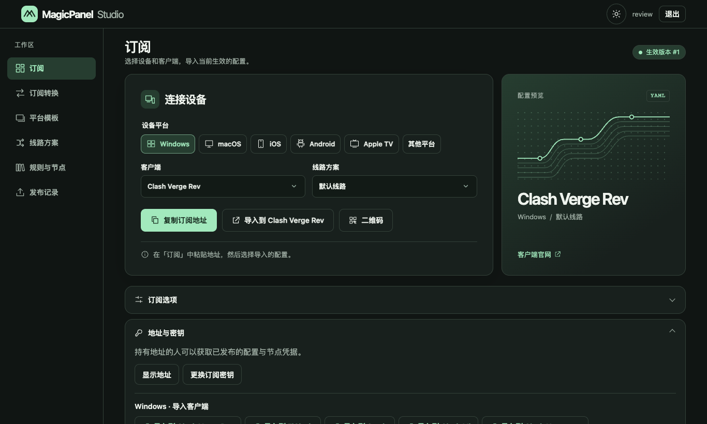
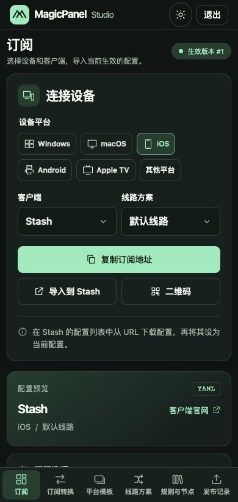

# MagicPanel Studio

独立的订阅、平台模板与分流管理应用。前端使用 Svelte、TypeScript 和 Vite，后端使用 FastAPI 与 SQLite。平台模板、客户端适配与线路方案分别维护，发布时生成完整配置。

- [用户任务与页面](docs/product.md)
- [架构、数据与恢复](docs/architecture.md)
- [开发验证、安装与发布](docs/delivery.md)
- [统一订阅使用说明](docs/订阅与分流设计报告.md)
- [平台模板与线路方案](docs/platform-experience.md)
- [客户端导入与规则管理](docs/界面与规则管理验收.md)
- [客户端适配与协议字段](docs/客户端交付与界面二期.md)
- [独立订阅转换工具](docs/独立订阅转换工具.md)

## 界面预览

截图使用演示数据；支持范围以当前客户端目录及发布校验结果为准。

| 手机订阅 | 手机转换 |
| --- | --- |
|  |  |

[桌面转换](docs/preview/转换-桌面浅色.png) · [桌面模板](docs/preview/平台模板-桌面.png) · [手机模板](docs/preview/平台模板-手机.png) · [手机规则](docs/preview/客户端规则-手机.png)

`studio/` 是独立源码与交付单元；仓库根目录的旧应用、数据库和部署脚本不属于 Studio。真实环境的地址、部署回执与恢复材料由维护者在本地保存。
